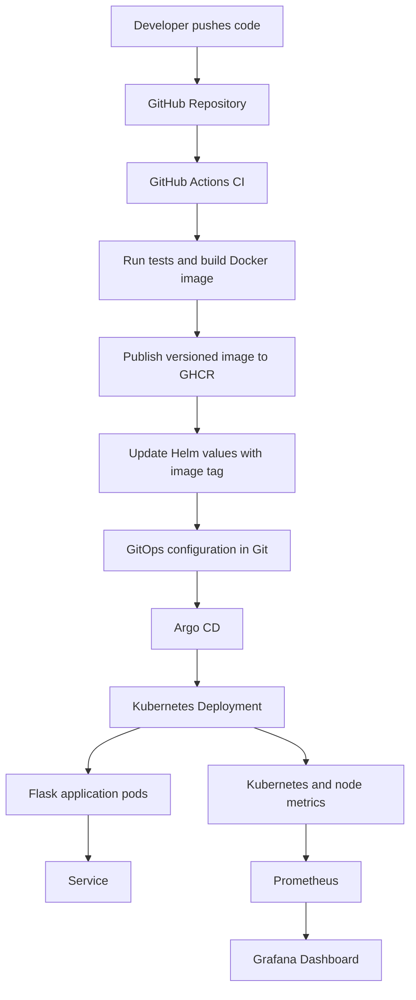

# GitOps-Based Kubernetes CI/CD Platform

A hands-on DevOps project demonstrating automated testing, container image publishing, GitOps-based Kubernetes deployment, and application and infrastructure monitoring.

## Overview

This project implements a CI/CD workflow for a Python Flask application using GitHub Actions, Docker, GitHub Container Registry (GHCR), Helm, and Argo CD. Prometheus collects metrics from the Kubernetes environment, while Grafana provides dashboards for monitoring application pods and node resource usage.

The project demonstrates how application changes can move from source control to a container image and then into a Kubernetes deployment through GitOps.

## Architecture


## Grafana Monitoring Dashboard

The platform includes a Grafana dashboard powered by Prometheus metrics collected from the local Kubernetes environment.

The dashboard tracks:

- Application pod CPU and memory usage
- Desired versus available application replicas
- Minikube node CPU and memory utilization
- Application pod restarts over the last hour


The dashboard provides visibility into workload health and resource utilization during deployment and testing.

## Technology Stack

| Technology | Purpose |
|---|---|
| Python and Flask | Application and HTTP endpoints |
| Pytest | Automated tests |
| Docker | Containerization |
| Gunicorn | Production-style WSGI application server |
| GitHub Actions | CI automation |
| GitHub Container Registry | Container image storage |
| Kubernetes | Container orchestration |
| Helm | Kubernetes application packaging and configuration |
| Argo CD | GitOps continuous delivery |
| Prometheus | Metrics collection and querying |
| Grafana | Monitoring dashboards |
| Minikube | Local Kubernetes environment |

## Application Endpoints

- `/` — Returns application information and version as JSON.
- `/health` — Returns a health status response with HTTP 200.

The application runs using Gunicorn inside the Docker container.

## CI/CD and GitOps Workflow

1. A developer pushes application changes to GitHub.
2. GitHub Actions runs the configured validation and test steps.
3. The workflow builds the Docker image and publishes it to GHCR.
4. The workflow updates the image tag in the Helm chart values file.
5. Argo CD monitors the configured Git repository and Helm chart path.
6. Argo CD reconciles the desired application configuration with the Kubernetes environment.
7. Kubernetes runs the application replicas and uses the configured health probes.

The image tag is tied to the source commit, making the deployed image traceable to a specific revision.

## Kubernetes Deployment

The Helm chart is located in `gitops-app/`. It defines the application resources and configuration used by Argo CD.

The deployment includes:

- A Kubernetes Deployment for the Flask application.
- Two desired application replicas.
- A Kubernetes Service for application access.
- Readiness and liveness probes using `/health`.
- A configurable container image repository and tag.

The Argo CD Application manifest is located at `argocd-application.yaml`.

## Monitoring and Observability

The monitoring stack is installed in the `monitoring` namespace using the `kube-prometheus-stack` Helm chart.

The Grafana dashboard, **GitOps Kubernetes Platform**, contains seven panels:

1. Application pod CPU usage.
2. Application pod memory usage.
3. Available application replicas.
4. Desired application replicas.
5. Minikube node CPU usage.
6. Minikube node memory usage.
7. Application pod restarts over the last hour.

Prometheus queries can also be used to inspect Kubernetes workload and node metrics.

The monitoring configuration used for installation is stored in `monitoring-values.yaml`.

## Challenges and Troubleshooting

### 1. Monitoring Stack Resource Constraints

**Challenge:** Grafana experienced liveness-probe failures and container restarts during initial setup.

**Resolution:** Adjusted Grafana resource allocations and liveness-probe timing, then verified that the pod reached a healthy running state.

**Learning:** Kubernetes resource configuration and health-probe timing must account for application startup and runtime requirements.

### 2. Git Synchronization in the CI/CD Workflow

**Challenge:** A Git push was rejected after the CI workflow updated the Helm image tag on the remote branch.

**Resolution:** Pulled and reconciled the remote changes before pushing the local commit successfully.

**Learning:** CI automation that commits deployment configuration introduces additional Git synchronization considerations. Keeping application source and deployment configuration traceable is important in GitOps workflows.

### 3. Prometheus Query Development

**Challenge:** Monitoring application health required identifying the appropriate Kubernetes and container metrics rather than relying on a single metric.

**Resolution:** Developed PromQL queries for CPU usage, memory usage, replica availability, desired replica count, node utilization, and pod restarts.

**Learning:** Useful observability requires selecting metrics that answer specific operational questions, not simply collecting metrics without context.

### 4. Container Runtime Configuration

**Challenge:** The application needed a more production-oriented way to serve HTTP requests inside its container.

**Resolution:** Configured Gunicorn with two workers and validated application endpoints and server logs.

**Learning:** Containerizing an application involves both packaging the application and choosing an appropriate process for serving requests.

## Repository Structure

```text
.
├── .github/
│   └── workflows/
│       └── ci.yml
├── app/
│   ├── app.py
│   └── requirements.txt
├── gitops-app/
│   ├── templates/
│   ├── Chart.yaml
│   └── values.yaml
├── k8s/
├── tests/
├── Dockerfile
├── .dockerignore
├── .gitignore
├── argocd-application.yaml
├── monitoring-values.yaml
└── README.md
```

## Local Development

### Prerequisites

- Git
- Python 3.12 or compatible Python environment
- Docker
- kubectl
- Minikube
- Helm

Argo CD and the monitoring stack are required for the full GitOps and observability workflow.

### Run the application tests

From the repository root:

```bash
python -m pytest -v
```

### Build the Docker image

```bash
docker build -t gitops-k8s-platform:local .
```

### Run the container

```bash
docker run --rm -p 5000:5000 gitops-k8s-platform:local
```

In another terminal, test the endpoints:

```bash
curl http://localhost:5000/
curl http://localhost:5000/health
```

### Validate the Helm chart

```bash
helm lint ./gitops-app
```

### Inspect Kubernetes resources

With the local Kubernetes cluster running:

```bash
kubectl get pods
kubectl get deployments
kubectl get services
kubectl get pods -n monitoring
```

## Future Improvements

- Add automated deployment smoke tests after rollout.
- Configure application-specific Prometheus metrics and scraping.
- Introduce alerting rules and notification integrations.
- Add security scanning for dependencies and container images.
- Configure persistent storage and resource-aware monitoring for longer-running environments.
- Explore automated rollback strategies and progressive delivery.

## Project Goals

This project is intended to demonstrate practical experience with containerization, CI automation, Kubernetes deployment, GitOps reconciliation, Helm-based configuration, and monitoring.

It runs in a local Minikube environment; it is a learning and portfolio project rather than a production deployment.